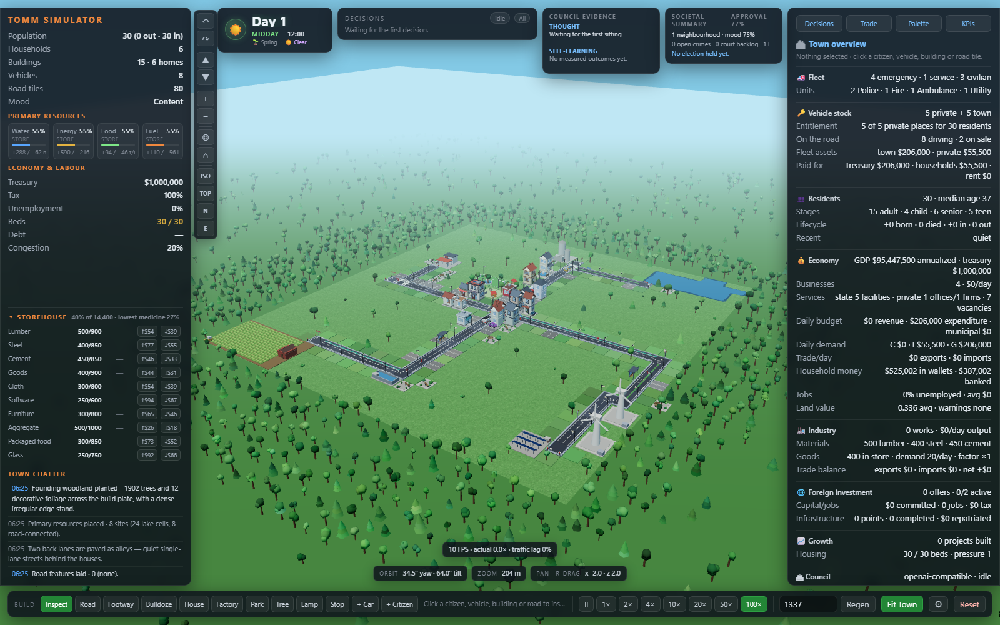

# Town of Many Minds

**TOMM** is a browser-based 3D town simulator for observing how a language model governs a changing town. Five Cabinet ministers propose actions, a sixth Council call selects priorities, and the Mayor validates the resulting motions. Residents, private developers, traffic, industry and public services continue through their own simulation systems.



The experiment measures decisions and consequences: can a model maintain food supply, create viable jobs, manage public debt and expand a road network without wasting land? Council traits emerge from choices and recorded outcomes rather than from a prescribed personality.

- **Runs entirely in the browser.** three.js, no backend, no database.
- **Bring your own model.** Any OpenAI-compatible endpoint (LM Studio, llama.cpp, Ollama, vLLM) or a built-in offline mode.
- **Everything is inspectable.** `window.town` and friends are on the console; the ledger, the decision log and the KPI panel export JSON.
- **Nothing is scripted.** Rules decide *what is legal*; the model decides *what to do*.

---

## How governance works

Each scheduled sitting makes up to six provider calls: one per Cabinet department, then one Council synthesis call. The departments and their remits (from `src/data/cabinet.json`):

| Department | Remit | Example intents |
| --- | --- | --- |
| Treasury & Economy | Keep the town solvent, productive, employed and supplied | `TRADE_BUY`, `BUILD_FACTORY`, `RAISE_TAX`, `BOND_ISSUE` |
| Land & Housing | Place homes safely; acquire frontier land only when serviced plots are exhausted | `ACQUIRE_LAND`, `DEVELOP_HOUSING`, `UPGRADE_BUILDING` |
| Infrastructure & Mobility | Relieve measured congestion and connect destinations | `EXTEND_STREET`, `UPGRADE_ROAD`, `BUILD_TRANSIT` |
| Public Services & Utilities | Maintain water, power, sewage, waste and emergency coverage | `UPGRADE_RESOURCE`, `BUILD_CIVIC`, `DISPATCH_UNITS` |
| Society, Education & Culture | Respond to mood, approval, safety, education and recreation demand | `HOST_EVENT`, `ENACT_SCHEME`, `PASS_LAW` |

The Mayor approves at most five motions per sitting (`motionsPerSitting: 5`), emergencies first. A sitting that runs past **20 s** is aborted and retried on the next slot; after **3 consecutive failures** the default mode stops asking the model and shows `Council paused · N failures` — it does not substitute automatic public construction. Bounded outcome memory lets later sittings weigh what earlier motions actually did.

The Council report is the model's entire input. It carries the measured town state, the intent map (which actions are feasible, which are blocked and why), the staffing gap, the congestion evidence, the commodity demand ranking and the learning record — so the model is answering a question about the town rather than being handed a menu.

---

## Run locally

Use **Node.js 22.12+**, npm, and a browser with WebGL support. Development and regression work has also used Node.js 24.

```sh
git clone https://github.com/abanerjee84/town-of-many-minds.git
cd town-of-many-minds
npm ci
npm run dev
```

Open the address Vite prints — its configured port is **5173**, and it picks another only if that one is busy. Do not open `index.html` from the filesystem; the app needs the Vite module server.

### Connect a model

For autonomous public decisions, run an OpenAI-compatible local model server (for example LM Studio) with a loaded model at **http://localhost:1234**; Vite forwards `/lm/v1` requests to it and strips the `/lm` prefix. If your server requires an explicit model identifier, set it from the browser console — there is no provider form in Settings:

```js
town.governance.setProvider('openai-compatible', {
  endpoint: '/lm/v1',
  model: 'your-loaded-model-id'
});
```

See [local model setup](docs/getting-started.md) and the [provider contract](docs/council.md#connecting-a-provider).

### Run without a model

**Without a responding model**, the town still runs: residents, traffic, industry, weather and manual construction all work. The Council card reads `offline · awaiting Council`, then `Council paused · 3 failures` once repeated calls fail, and the decision log stays empty — no public work is commissioned by a rules fallback. Turn off *Automatic LLM Council* in Settings while inspecting a disconnected run to avoid repeated request waits.

---

## A verified default run

The following was captured with the headless Playwright probe (`scripts/_readme_probe.mjs`) against `npm run dev`, seed 1337. Re-run it yourself:

```sh
$env:APP_URL = 'http://localhost:5173'
node scripts/_readme_probe.mjs                    # with whatever the /lm proxy serves
$env:PROBE_NO_MODEL = '1'; node scripts/_readme_probe.mjs   # forced offline run
```

The probe writes `scripts/_readme_probe.report.json` and refreshes the screenshots in `docs/assets/`.

### Founding state

| Fact | Observed value |
| --- | --- |
| Opening state | Day 1, 07:30, Spring, Clear; **$1,000,000** treasury |
| Founding town | 30 residents in 6 households (30/30 beds), 15 buildings (6 homes), 8 vehicles, 80 road tiles |
| Private sector | 4 firms (1 office, 3 retail), each opened with **$250,000** of developer equity and **$0** debt |
| Developer | $12,000,000 of undeployed private capital |
| Default speed | 100×; the calendar advanced **~2 game days in 20 wall-clock seconds** even under software rendering (8–9 FPS) |

### After three game days, no model connected

| Fact | Observed value |
| --- | --- |
| Treasury | $997,845 · tax 100% · unemployment 0% · congestion 14% · mood *Settled* |
| Private sector | $1,000,400 business cash, **$0** business debt, **$0** outstanding loans |
| Audit | `ok: true`, no unexpected money creation, no unreconciled transfers |
| Council | `offline · awaiting Council` → `Council paused · 3 failures`; decision log empty; no fallback construction |

### With a model connected

A local OpenAI-compatible server was reachable through the `/lm` proxy for this capture, so the Council actually sat:

| Fact | Observed value |
| --- | --- |
| Sittings | 2 sittings, **5 decisions** recorded in 2 game days |
| KPI counters | attempted 5 · accepted 4 · completed 1 · priority actions 3 · priority remedies 2 · repeat-blocked 0 |
| Attributed spend | **$113,502** across the 5 decisions; treasury low-water mark $992,152 |
| World response | 84 road tiles (the Council extended the network), 10 vehicles, treasury $994,498 |
| Audit | `ok: true`, zero rejected transactions |

### Interface read-outs

| Panel | Observed value |
| --- | --- |
| KPI modal | `Run 1337 · day N · <provider>` with JSON export; sections **Decision quality** (constraint compliance, action throughput, priority response, repeat-blocked rate) and **Town outcomes** (treasury safety, congestion relief, population, approval/mood) |
| Trade modal | Per-product daily demand table — e.g. goods 20/day, lumber 20.0, cement 14.4, steel 4.1, software 0.88, packaged food 0.69 — with stock days, priority and remedy |
| Palette modal | Quoted construction blocks, e.g. Town Hall $27,158 / 32 h, School $108,630 / 32 h, University $218,925 / 36 h |

Starting defaults (from `src/core/settings.js` and the rule files): **$1,000,000 treasury**, **30 founding residents**, **100× speed**, **two Council sittings per day**, **up to five approved motions per sitting**, **council creativity 0.15**, **shadows off**, automatic LLM Council on, maximum population 1000. Residential capacity is **three residents per footprint tile per floor** (setting range 1–8). These are model rules, not real-world forecasts.

---

## What the town simulates

| Area | Implemented behaviour |
| --- | --- |
| Governance | Five department-specific calls, Council synthesis, Mayor validation, immediate remedy correction, bounded outcome memory |
| Land and buildings | A compact acquired founding town inside a 100 × 100 plate; paid frontier acquisition, horizontal footprints, floors, wings, civic upgrades, residential communities |
| Economy and work | Separate public/private accounts, taxes and municipal fees, household savings, wages, loans and bonds, developer acceptance, training and service-sector jobs |
| Industry | Capacity-scaled factories, input recipes, shared commodity inventories, dynamic prices, imports and exports, a daily demand ranking shared by the Cabinet |
| Mobility | Congestion evidence across sittings, graph-based street evaluation, road upgrades, bridges, parking, buses, signals and emergency fleets (founding fleet: 2 police, 1 fire, 1 ambulance) |
| Civic life | Schools and healthcare, neighbourhoods, mood and approval, crime and justice records, elections, schemes and laws |
| Environment | Seasons, visible weather, day/night lighting, fog and sky, woodland, clearing and planting linked to lumber |
| Evaluation | Inspectable decisions, KPI panel with JSON export, provider benchmarks, pre-sitting MapNow text exports, forced-request regressions |

Every one of those systems shares one **ledger**. `EconomySystem.transfer()` records every movement between the treasury, households, businesses, the developer, the contractor, the bank and foreign investors; `economy.audit()` re-derives the town's total money from the accounts and compares it with the expected total, so an unbalanced run is reported rather than hidden. The treasury's growth is never inferred from a single state's project price.

---

## Interface tour

- **Left HUD** — population (with out/in split), households, buildings, vehicles, road tiles, mood; primary resource gauges (stock bar + daily flow); treasury, tax, unemployment, beds, debt, congestion; a collapsible Storehouse commodity table; and the town chatter log.
- **Top strip** — the clock (day, period, time, season, weather) beside the Decisions card (sitting count, state chip, latest motions with actor tags), plus Council evidence (current thought, measured self-learning) and a societal summary (approval, neighbourhoods, elections).
- **Right inspector** — town overview and fleet by default; click any citizen, vehicle, building or road tile to inspect it. Four buttons open full views: **Decisions** (who did what and why), **Trade** (industry demand & trade), **Palette** (quoted construction blocks), **KPIs** (filterable rows + JSON export).
- **Bottom ribbon** — twelve tools (Inspect, Road, Footway, Bulldoze, House, Factory, Park, Tree, Lamp, Stop, + Car, + Citizen), the speed cluster (paused through 100×, eight steps), the seed field with **Regen**, **Fit Town**, Settings and **Reset**.
- **Camera rail** — orbit/tilt/zoom buttons, fit/home, and ISO / TOP / N / E presets; a readout chip shows orbit, zoom and pan. A second chip reports measured FPS, actual calendar rate, and traffic lag.

---

## Architecture

```
src/core        config, clock, settings, events, performance meter, grid, spatial index, pathfinding
src/simulation  town, economy, governance, cabinet, industry, traffic, society, growth, policy, KPIs, …
src/kits        construction kits (houses, civic, resources, roads, vehicles, glow) and the kit registry
src/placement   founding layout, site rules, validation, placement pipeline
src/world       three.js scene manager
src/ui          HUD, interaction tools, inspector modals
src/data        25 JSON rule files (cabinet, economy, world, price chart, KPI rules, …)
scripts/        80+ Node + Playwright regression checks and doc tooling
docs/           22 Markdown files: usage guides, implementation docs and reference tables
BuildContracts/ SRS, TODO, hardcode audit
```

The main loop is one `requestAnimationFrame` chain in `src/main.js`. Each subsystem runs inside `step(name, fn)`, which contains faults to themselves: a throw in one system is logged once, that system is skipped, and the town keeps running. The loop always reschedules — that is the one guarantee it makes.

Simulation time is driven by `src/core/clock.js`. While the Council is waiting on a provider the clock is held at zero, so the town report the model reads is the town that existed when the question was asked.

**Rules live in data, not in code.** `src/data/` holds the tax and wage schedule, the construction price chart, the growth and priority gates, the commodity catalogue and recipes, the service coverage ratios, the vehicle catalogue, the weather model and the KPI targets. Adding a construction block, a commodity, a scheme or a job family is a data edit; the board, the parser, the prompt and the report all read the same table.

**Extension points.** `src/kits/` is a registry of construction kits. A kit declares its blocks, footprint rules, materials, build hours and rendering; `npm run test:kit-registry` checks that every registered block is reachable and every compatibility rule holds. See [the kit guide](docs/kits.md).

---

## Develop and verify

```sh
npm run build          # production bundle
npm run docs:check     # documentation links, tables and generated references
npx playwright install chromium
```

Browser regressions require a running Vite server. Point them at it explicitly — the scripts have differing fallback ports, so `APP_URL` is the reliable route:

```powershell
$env:APP_URL = 'http://localhost:5173'
npm run test:cabinet-remedy
npm run test:kit-registry
```

`scripts/` holds 80+ Node regression checks (economy, housing, industry, traffic, governance, performance) plus Playwright browser checks; `npm run docs:check` verifies the documentation links and tables. See [testing](docs/testing.md) for the full command list, forced requests and horizon-test costs.

### Current state

| Suite | Result |
| --- | --- |
| `npm run build` | passes |
| `npm run docs:check` | passes — 5 generated references, 61 intents, 81 construction blocks, 16 settings, 0 faults |
| 74 `test:*` scripts | **72 pass**, including every economy, housing, industry, traffic, governance and performance check |
| Horizon checks | `test:metropolis`, `test:road-horizon`, `test:unemployment-horizon` and `test:soak` all reach 800–1200 game days with `audit.ok: true` and no page errors. These take several minutes each, so exclude them from a quick sweep. |

Two known failures remain, both pre-existing and unrelated to ordinary runs:

- `test:bus-stuck` — the strict long-run bus/refuelling regression still does not finish refuelling inside its limits.
- `test:state-service` — once the town passes ~220 residents the emergency-coverage audit reports an ambulance shortfall: a second unit is required, and the purchase is refused because the treasury is below the operating reserve floor.

---

## Known limitations

- The browser owns the live run. Background tabs are throttled, and public decision calls temporarily hold simulation time.
- Large towns can advance the calendar faster than their bounded traffic budget; the performance chip reports the resulting lag.
- The bus queue/refuelling regression is unresolved, and emergency-service coverage does not yet close its own shortfall.
- A simulation Web Worker remains planned work.
- Making this repository public does not introduce a software licence; no `LICENSE` file is currently supplied.

---

## Explore the documentation

- [Start and connect a local model](docs/getting-started.md)
- [Controls, panels and settings](docs/user-guide.md)
- [Council, Cabinet, Mayor and provider API](docs/council.md)
- [World, placement and building progression](docs/world-construction.md)
- [Economy, employment, factories and investment](docs/economy-employment.md)
- [Industry demand and supply chains](docs/industry-demand.md)
- [Road planning, traffic and public transport](docs/mobility.md)
- [Society, resources, seasons and forestry](docs/society-environment.md)
- [Kit system and extension guide](docs/kits.md)
- [KPIs, benchmarking and MapNow](docs/evaluation.md)
- [Architecture and runtime](docs/architecture.md) · [Configuration and rule ownership](docs/configuration.md)
- [Testing and regression selection](docs/testing.md) · [Deployment](docs/deployment.md) · [Troubleshooting](docs/troubleshooting.md)
- [All documentation and reference tables](docs/README.md)

---

## Project status

TOMM is an experimental simulator. The live app exposes `window.town`, `window.clock`, `window.mapNow` (`capture()` / `save()`), `window.forceCouncilRequest`, `window.councilSnapshot` and `window.scoreCouncilRun` on the console for inspection; MapNow saves land in `MapNow/` via the Vite dev server.

See [known limitations](docs/troubleshooting.md#known-limitations), the [SRS](BuildContracts/SRS.md) and the [TODO](BuildContracts/TODO.md) for measured status.
